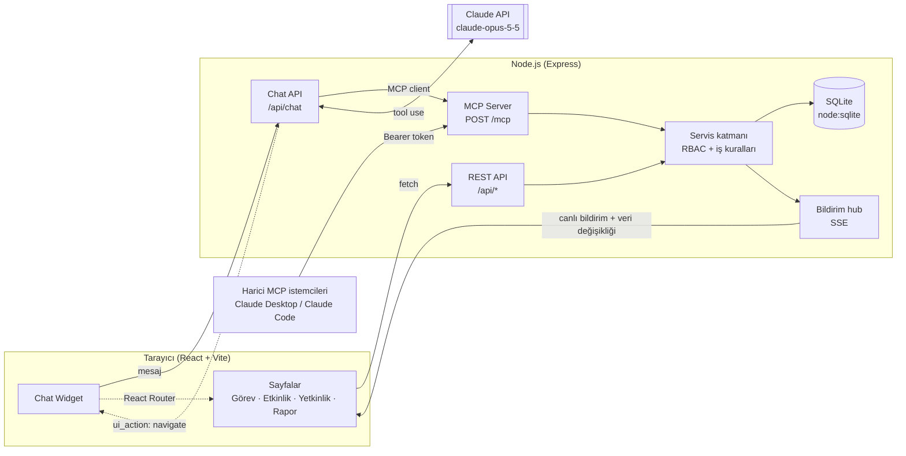

# 🛡️ CyberOps — Siber Güvenlik Görev Yönetimi

Siber güvenlik ekiplerinin günlük işlerini, yedek sorumluluklarını, etkinlik ve yetkinliklerini yöneten; **MCP tabanlı AI asistanı** ile konuşarak kullanılabilen demo uygulaması.

> "Kritik açık görevleri göster" → asistan MCP tool'larıyla veriyi çeker **ve ekranı ilgili sayfaya, filtreler uygulanmış halde yönlendirir.**

## Özellikler (görev gereksinimleri ↔ karşılığı)

| Gereksinim | Uygulamadaki karşılığı |
|---|---|
| **Task Yönetimi:** günlük ve yedek işlerin atanması, takibi | Görev türleri (Günlük / Yedek / Proje / Olay), **sorumlu + yedek sorumlu**, öncelik, bitiş tarihi, günlük/haftalık **tekrarlayan görevler** (tamamlanınca bir sonraki otomatik oluşur), liste + **Kanban** (sürükle-bırak), yorumlar, gecikme takibi |
| **Etkinlik ve İletişim Yönetimi:** bireysel/kurumsal etkinlikler, bireysel yetkinlikler | Konferans / eğitim / CTF / webinar / meetup / sınav; **bireysel & kurumsal katılım**, konuşmacı/organizatör rolleri; **yetkinlik matrisi** (1-5 seviye), sertifikalar + süre dolum uyarısı, kişi bazlı etkinlik geçmişi; **duyurular** (ekip / organizasyon) |
| **Yetkilendirme:** çalışan, yönetici, direktör | Hiyerarşik RBAC: çalışan → kendi işleri, yönetici → ekibi, direktör → tüm organizasyon + rol yönetimi. **Aynı kurallar REST, MCP ve chatbot'ta** (tek servis katmanı) |
| **Raporlama ve Bildirim:** toplu raporlama ve bildirimler | Durum/öncelik/tür dağılımı, 14 günlük trend, kişi ve ekip bazlı iş yükü, gecikmiş görevler, **CSV/Excel dışa aktarma**, **toplu bildirim (digest)**; atama, durum değişikliği, yorum, gecikme, etkinlik ve duyuru için **canlı bildirimler (SSE)** |
| **Veri Paylaşımı:** API veya MCP | **REST API** + **MCP Server** (Streamable HTTP, 19 tool). Kişisel token ile Claude Desktop / Claude Code gibi harici MCP istemcileri bağlanabilir |
| **Ekstra: AI chatbot + MCP ile önyüz yönlendirme** | Claude (tool use) → MCP istemcisi → MCP server; `ui_navigate` tool'u ile arayüz yönlendirmesi. API anahtarı yoksa **kural tabanlı Türkçe niyet motoru** aynı MCP tool'larını kullanır (demo hiçbir koşulda çökmez) |

## Mimari



**Chatbot akışı**
1. Kullanıcı mesajı → `POST /api/chat` (kullanıcının JWT'si ile)
2. Sunucu, **kullanıcının token'ıyla** kendi MCP server'ına MCP istemcisi olarak bağlanır → `tools/list`
3. Tool listesi Claude'a verilir; Claude `list_tasks`, `create_task`, `get_report`… çağırır (rol kapsamı MCP'de uygulanır)
4. Claude `ui_navigate({page, filters, highlight_id})` çağırırsa sonuç `ui_action` olarak önyüze döner
5. Chat widget React Router ile sayfayı açar; sayfa URL filtrelerini okuyup listeyi filtreler, kaydı vurgular

## Tech Stack

| Katman | Teknoloji | Neden |
|---|---|---|
| Önyüz | **React 19**, **Vite 8**, **Tailwind CSS 4**, React Router 7, Recharts, lucide-react | Hızlı geliştirme, tek komutla build |
| Backend | **Node.js 24**, **Express 5** | Tek dil (JS), minimum kurulum |
| Veritabanı | **SQLite** (`node:sqlite`, Node'a gömülü) | Native derleme yok, sıfır kurulum |
| Kimlik | JWT (demo: şifresiz rol seçimi), rol bazlı yetki | 3 seviyeli RBAC |
| AI | **Claude API** (`@anthropic-ai/sdk`, `claude-opus-5-5`, tool use, adaptive thinking, server-side fallback) | Doğal dil → aksiyon |
| Entegrasyon | **MCP** (`@modelcontextprotocol/sdk`, Streamable HTTP, stateless), REST | Standart AI entegrasyonu |
| Bildirim | Server-Sent Events | Canlı bildirim + sayfaların otomatik yenilenmesi |

## Kurulum ve Çalıştırma

Gereksinim: **Node.js 22.13+** (24 önerilir).

```bash
npm run install:all          # root + server + web bağımlılıkları
cp server/.env.example server/.env   # (opsiyonel) ANTHROPIC_API_KEY ekle
npm run dev                  # API :3001 + Web :5173
```

Tarayıcıda **http://localhost:5173** → demo kullanıcısı seçin.

- `ANTHROPIC_API_KEY` tanımlıysa chatbot **Claude** ile çalışır, yoksa **kural tabanlı modda** çalışır (mesajlardaki rozet hangisinin cevap verdiğini gösterir).
- Demo verisini sıfırlamak: `npm run seed`
- Tek port prod modu: `npm run build && npm start` → http://localhost:3001

## Demo Senaryosu (≈5 dk)

1. **Mehmet Demir (Yönetici)** ile giriş → panel: ekip durumu, bugünkü işler
2. Asistan (`Ctrl+K`) → **"Kritik açık görevleri göster"** → ekran Görevler sayfasına filtreli açılır; mesajda çağrılan MCP tool rozetleri görünür
3. **"Görev oluştur: SIEM korelasyon kuralı güncelleme, Can'a ata, öncelik yüksek"** → görev oluşur ve vurgulanır
4. Sağ üstten **Can Öztürk**'e geç → canlı bildirim zilinde yeni görev; **"#25 numaralı görevi incelemeye al"**
5. Mehmet'e dön → bildirim: "İncelemeye gönderildi"; **"Raporu göster"** → grafikler, **CSV** indir, **Toplu bildirim gönder**
6. **Ayşe (Çalışan)** → Raporlar menüde yok; "Burak'a görev ata" → yetki hatası (RBAC chatbot'ta da geçerli)
7. **Zeynep (Direktör)** → tüm organizasyon, Ekip & Yetki'den rol değiştirme
8. **API & MCP** sayfası → token oluştur → `claude mcp add ...` komutuyla Claude Code'dan aynı verilere bağlan

## MCP'ye harici istemciden bağlanma

API & MCP sayfasından token alın, ardından:

```bash
claude mcp add --transport http cyberops http://localhost:3001/mcp \
  --header "Authorization: Bearer <TOKEN>"
```

**Tool'lar:** `whoami`, `list_team_members`, `list_tasks`, `get_task`, `create_task`, `update_task`, `add_task_comment`, `list_events`, `create_event`, `join_event`, `list_competencies`, `add_skill`, `add_certification`, `list_announcements`, `create_announcement`, `get_report`, `send_digest_notifications`, `list_notifications`, `ui_navigate`

## Proje Yapısı

```
├── server/src
│   ├── index.js      # Express: REST + MCP + SSE + statik önyüz
│   ├── services.js   # İş kuralları + RBAC (REST ve MCP ortak)
│   ├── mcp.js        # MCP server (19 tool, ui_navigate)
│   ├── chat.js       # Claude tool-use döngüsü + kural tabanlı yedek
│   ├── notify.js     # Bildirim + SSE hub
│   ├── auth.js       # JWT, roller
│   ├── db.js         # SQLite şema
│   └── seed.js       # Demo verisi
└── web/src
    ├── App.jsx                 # Layout, menü, rol değiştirici, bildirim zili
    ├── components/ChatWidget.jsx
    └── pages/                  # Dashboard, Tasks, Events, Competencies, Reports, ...
```

## AI Kullanımı

- **Ürün içinde:** Claude, MCP üzerinden uygulama verisine rol kısıtlı erişir ve arayüzü yönlendirir.
- **Geliştirmede:** Proje, hackathon süresince Claude Code ile geliştirildi (mimari, kod, test ve dokümantasyon).
